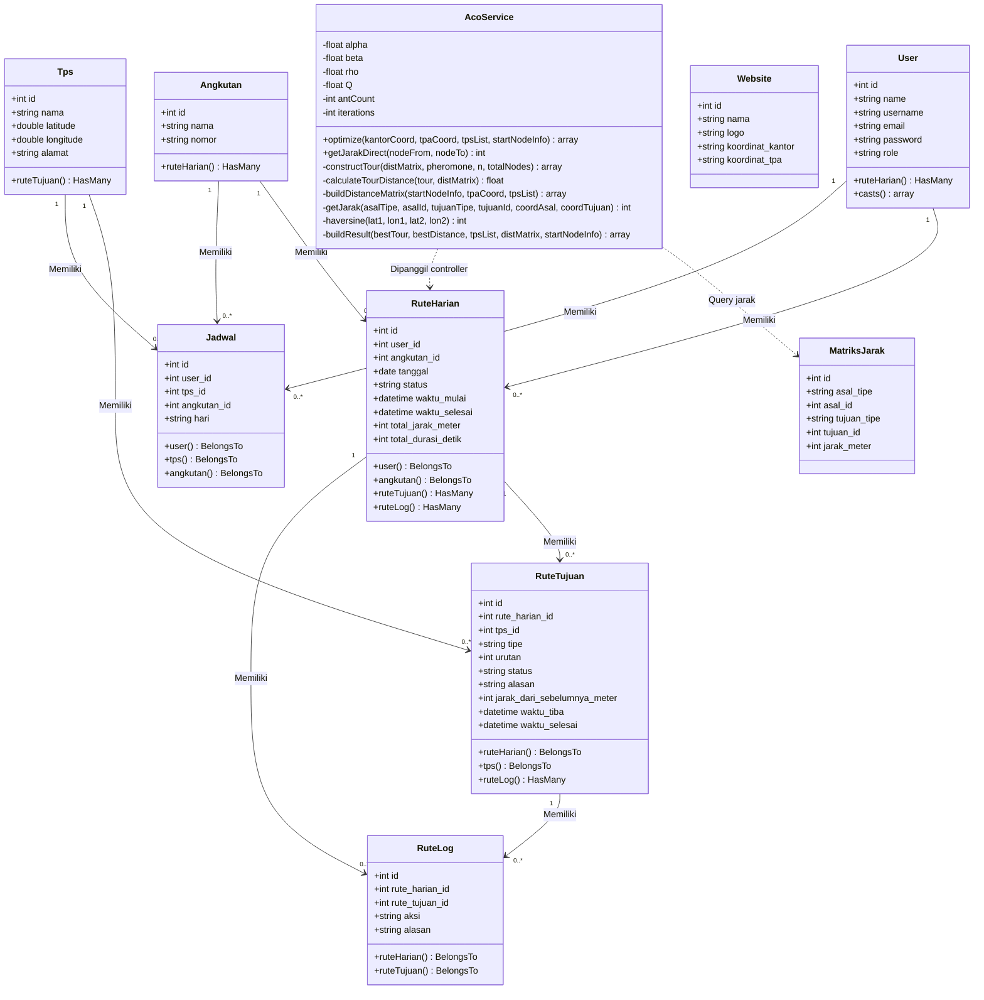
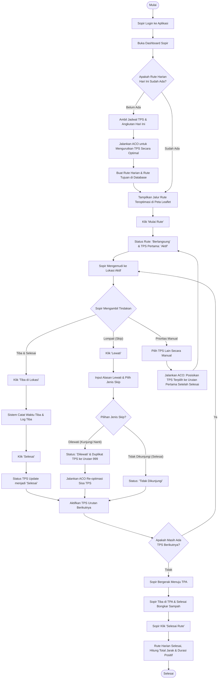
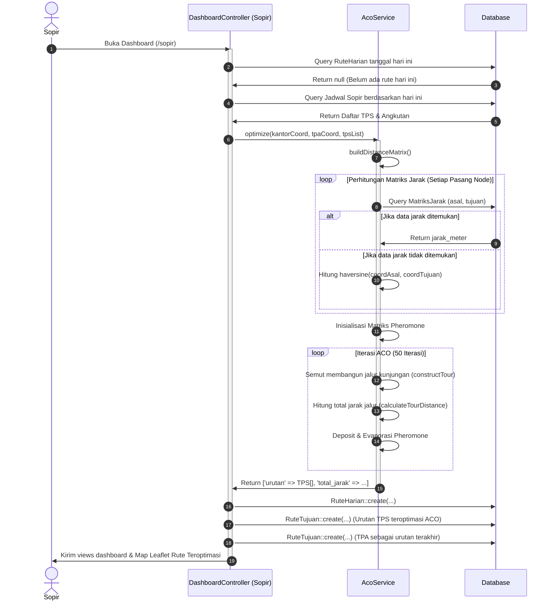
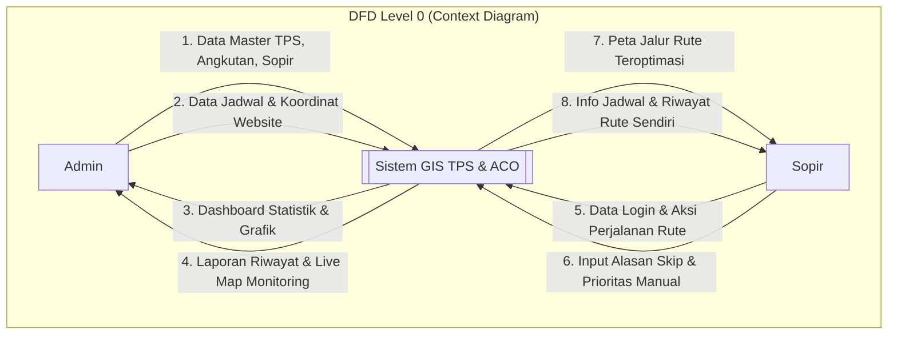
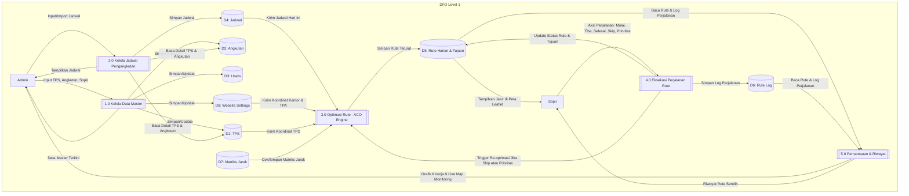

# Dokumentasi Diagram UML & DFD (Mermaid.js)

Dokumen ini berisi kode sintaks Mermaid.js untuk membuat diagram UML (_Use Case, Class, Activity, Sequence_) dan DFD (_Context Diagram & DFD Level 1_) dari sistem GIS Optimasi Rute Pengangkutan Sampah menggunakan Ant Colony Optimization (ACO).

Anda dapat menyalin (_copy_) kode di bawah ini dan menempelkannya langsung ke [Mermaid Live Editor](https://mermaid.live/) untuk menghasilkan diagram visualnya guna kebutuhan penulisan Bab 4 Skripsi.

---

## 1. Use Case Diagram

Diagram ini menggambarkan interaksi antara dua aktor utama (_Admin_ dan _Sopir_) dengan fungsionalitas sistem.

```mermaid
flowchart LR
    Admin[Admin]

    subgraph System ["Sistem GIS TPS & ACO"]
        UC_Login((Login Sistem))

        subgraph Admin_Features ["Fitur Kelola Admin"]
            direction TB
            UC_MasterTPS((Kelola Data TPS))
            UC_MasterAngkutan((Kelola Data Angkutan))
            UC_MasterSopir((Kelola Data Sopir))
            UC_Jadwal((Kelola Jadwal & Import/Export))
            UC_Website((Kelola Koordinat Kantor & TPA))
            UC_DashboardAdmin((Pantau Dashboard & Grafik Statistik))
            UC_MonitorRealtime((Pantau Live Rute & Timeline Sopir))
        end

        subgraph Sopir_Features ["Fitur Jalan Sopir"]
            direction TB
            UC_JadwalSopir((Lihat Jadwal Harian))
            UC_MulaiRute((Eksekusi Rute: Mulai Rute))
            UC_TibaSelesai((Eksekusi Rute: Tiba & Selesai))
            UC_SkipTPS((Eksekusi Rute: Lompati TPS dengan Alasan))
            UC_Prioritas((Eksekusi Rute: Prioritas TPS Manual))
            UC_SelesaiTPA((Eksekusi Rute: Selesai Rute di TPA))
            UC_RiwayatSopir((Lihat Riwayat Rute Sendiri))
        end
    end

    Sopir[Sopir]

    %% Hubungan Admin
    Admin --> UC_Login
    Admin --> UC_MasterTPS
    Admin --> UC_MasterAngkutan
    Admin --> UC_MasterSopir
    Admin --> UC_Jadwal
    Admin --> UC_Website
    Admin --> UC_DashboardAdmin
    Admin --> UC_MonitorRealtime

    %% Hubungan Sopir
    Sopir --> UC_Login
    Sopir --> UC_JadwalSopir
    Sopir --> UC_MulaiRute
    Sopir --> UC_TibaSelesai
    Sopir --> UC_SkipTPS
    Sopir --> UC_Prioritas
    Sopir --> UC_SelesaiTPA
    Sopir --> UC_RiwayatSopir
```

---

## 2. Class Diagram

Diagram ini memetakan kelas-kelas model Eloquent Laravel beserta relasi database dan method layanan algoritma ACO.

---

## 3. Activity Diagram (Eksekusi Rute & Dinamika ACO)

Diagram alur ini menggambarkan proses sopir memulai pekerjaan, bagaimana ACO mengoptimasi rute awal, serta alur percabangan ketika sopir melakukan _skip_ rute atau reorder prioritas rute secara manual.

---

## 4. Sequence Diagram (Generasi & Optimasi Rute ACO)

Diagram interaksi ini berfokus pada alur pemanggilan data dan penghitungan jalur terpendek ketika sopir membuka halaman dashboard pertama kali.

---

## 5. DFD (Data Flow Diagram)

Menyajikan alur aliran data dari entitas luar ke dalam proses sistem secara menyeluruh.

### DFD Level 0 (Context Diagram)

Menggambarkan batasan sistem secara makro serta aliran data utama antara sistem dengan _Admin_ dan _Sopir_.

### DFD Level 1

Menggambarkan sub-proses utama di dalam sistem dan hubungannya dengan penyimpanan data (_Data Store_).

